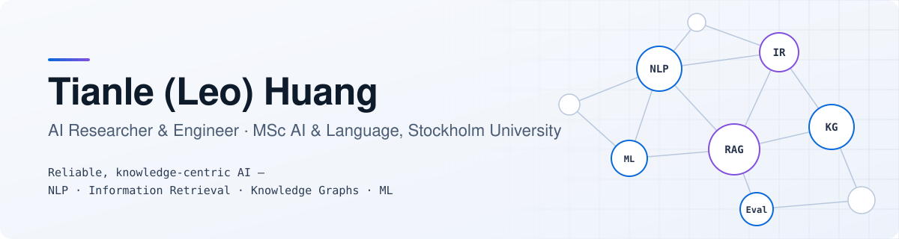

<picture>
  <source media="(prefers-color-scheme: dark)" srcset="assets/banner-dark.svg">
  
</picture>

  
  
  

  I build <b>reliable AI systems</b> across NLP, information retrieval, LLM agents, 
  speech, and machine learning — from research experiments to working prototypes.

 

## 🔬 Research & Experience

<table>
<tr>
<td width="34%" valign="top">

**🏭 Industrial Knowledge Systems** 
KTH × AstraZeneca · research collaboration

</td>
<td valign="top">

Retrieval and knowledge systems for industrial maintenance data.
- Retrieval-augmented generation with dense, structured, and hybrid retrieval
- Information extraction and knowledge graphs (Neo4j / Cypher)
- Evaluation of retrieval and answer quality

</td>
</tr>
<tr>
<td valign="top">

**🧪 Span-NER & Active Learning** 
MaintIE · public data

</td>
<td valign="top">

How much annotation does nested NER on maintenance text really need? → [`ae-ner-maintenance`](https://github.com/leoohuang/ae-ner-maintenance)
- Span-classification model on a Transformer encoder (PyTorch, Hugging Face)
- Pre-registered encoder pilot: BERT / RoBERTa / ModernBERT
- 10-seed learning curves: random vs. uncertainty vs. uncertainty + diversity, with paired significance tests

</td>
</tr>
<tr>
<td valign="top">

**🎙️ Speech Technology** 
KTH

</td>
<td valign="top">

Speech continuation under speaker-identity bias.
- Evaluating speech-language model continuations across speaker conditions
- Whisper transcription and an automated evaluation pipeline, incl. LLM-as-a-judge

</td>
</tr>
</table>

 

## 🧩 Featured Projects

<table>
<tr>
<td width="50%" valign="top">

### [ae-ner-maintenance](https://github.com/leoohuang/ae-ner-maintenance)
<i>How much labelled data does nested NER need?</i>

Span-based NER with an active-learning loop, token-budget grid, frozen protocols tagged in Git, and unit tests.

</td>
<td width="50%" valign="top">

### [maintenance-mind](https://github.com/leoohuang/maintenance-mind)
<i>Does the agent have enough evidence to answer?</i>

ReAct agent over work orders, manuals, and the web, with a self-reflection step after each tool round. Synthetic demo data.

</td>
</tr>
<tr>
<td width="50%" valign="top">

### [game-review-ir](https://github.com/leoohuang/game-review-ir)
<i>Does a retrieved review discuss the aspect asked for?</i>

Team project: BM25 + LLM aspect classification + aspect-aware reranking. **My part:** the evaluation module — aspect-level nDCG@10, qrels, permutation tests.

</td>
<td width="50%" valign="top">

### [Podsearch](https://github.com/leoohuang/Podsearch)
<i>Find the exact moment a podcast discusses a topic.</i>

Faster-Whisper transcription, BGE-M3 embeddings in ChromaDB, two-stage reranking (ZH / EN), playable audio clips.

</td>
</tr>
<tr>
<td width="50%" valign="top">

### [spoiler-detector](https://github.com/leoohuang/spoiler-detector)
<i>Safe, mild, or major spoiler?</i>

LLM-assisted labelling checked on a manual sample, sentence embeddings, four classical classifiers. [**Live demo →**](https://huggingface.co/spaces/leoole/spoiler-detector)

</td>
<td width="50%" valign="top">

### [swedish-vocab-trainer](https://github.com/leoohuang/swedish-vocab-trainer)
<i>Turn messy Swedish notes into practice.</i>

Local-first web app: file parsing, optional AI extraction that marks AI-added content, unit + end-to-end tests.

</td>
</tr>
</table>

<b>📚 More — NLP foundations, implemented from scratch</b>

 

| Project | What it covers |
|---|---|
| [postagging](https://github.com/leoohuang/postagging) | HMM vs. BiLSTM POS tagging on UD English-EWT, incl. OOV analysis |
| [statistical-nlp](https://github.com/leoohuang/statistical-nlp) | N-gram LM, HMM tagger, Viterbi, word segmentation |
| [multilingual-text-search](https://github.com/leoohuang/multilingual-text-search) | Cross-lingual word embeddings from parallel text via truncated SVD |
| [essay-score-regression](https://github.com/leoohuang/essay-score-regression) | Linear regression with manual backpropagation vs. scikit-learn |
| [obsidian-knowledge-ingest](https://github.com/leoohuang/obsidian-knowledge-ingest) | Agent skill that turns course material into a linked Obsidian knowledge base |
| [naiss-sbatch](https://github.com/leoohuang/naiss-sbatch) | SLURM job templates and GPU checks for the NAISS Arrhenius cluster |

 

## 🛠️ Technical Skills

  

| | |
|---|---|
| 🧠 **ML & Deep Learning** | PyTorch · Hugging Face Transformers · scikit-learn · NumPy · pandas · active learning |
| 🔎 **NLP & Retrieval** | nested / span NER · POS tagging · sentence embeddings · BM25 · FAISS · ChromaDB · BGE-M3 · reranking · RAG · LLM agents |
| 🎙️ **Speech** | Whisper / Faster-Whisper ASR · speech-language model evaluation |
| 🕸️ **Knowledge & Data** | information extraction · Neo4j / Cypher · ontologies · data cleaning & splitting |
| 📐 **Research & Evaluation** | SLURM on NAISS HPC (GPU) · pre-registered protocols · learning curves · nDCG / MRR / F1 · Wilcoxon & permutation tests · inter-annotator agreement · LLM-as-a-judge |
| ⚙️ **Engineering** | Python · TypeScript · R · Bash · Git · Linux · Docker · pytest · Vitest · Playwright |

 

## 🎯 Research Interests

  <code>Natural language processing</code>&nbsp;
  <code>Information retrieval & RAG</code>&nbsp;
  <code>LLM agents & evaluation</code> 
  <code>Speech & language</code>&nbsp;
  <code>Data-efficient learning</code>&nbsp;
  <code>Reliable AI systems</code>

 

  Open to research collaborations, research-engineering roles, and PhD opportunities in NLP, IR, and applied ML.

